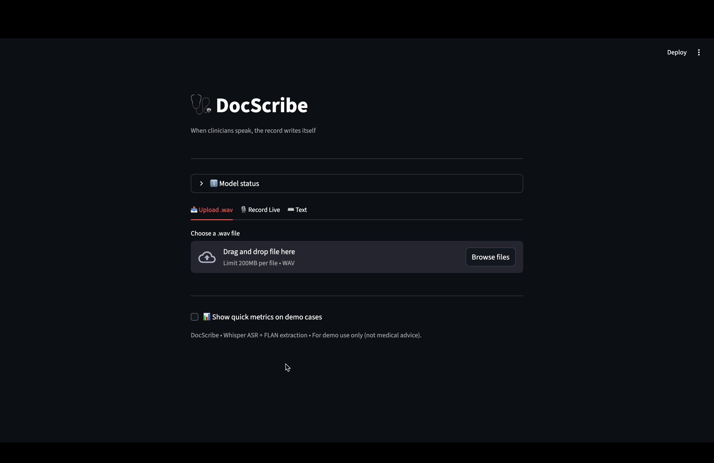

# 🧠 DocScribe — Voice to Structured Clinical Notes
**Gator Hack IV | AI in Healthcare**

> DocScribe turns clinician dictation into a structured, reviewable note: Whisper transcribes the audio, Flan-T5 plus rule-based post-processing extracts predefined clinical fields, and every extracted value is linked back to the transcript text it came from.

---

## 🎥 Demo Video

[](https://youtu.be/1QC1WcAI1aY "DocScribe Demo")

---

## 🌟 Overview

Clinicians spend a large share of their day on documentation. DocScribe explores whether AI can take natural dictation and organize it into a standard note, while keeping the clinician in control and every output traceable.

- 🎙️ **Transcribe** spoken dictation (Whisper)
- 🧩 **Extract** predefined fields: chief complaint, assessment, diagnosis, orders, plan, follow-up (Flan-T5 + rules)
- 📋 **Compose** a SOAP note and a short visit summary
- 🔍 **Link evidence**: every extracted value is stored with its character span in the transcript and highlighted in the app
- ✏️ **Review and edit** fields before re-composing the note
- 📤 **Export** the note and its evidence as JSON, or the SOAP note as text

---

## 🧱 Architecture

```text
🎤 Clinician dictation
     ↓ Whisper (ASR)
📝 Editable transcript
     ↓ Flan-T5 extraction (schema prompt + per-field fallback prompts)
     ↓ Rule-based post-processing (splitting, orders vs plan routing, dosage patterns)
     ↓ Grounding check: values not found in the transcript are dropped
{ chief_complaint, assessment, diagnosis[], orders[], plan[], follow_up }
     ↓ Evidence spans (start/end offsets in the transcript)
📋 SOAP note + visit summary  →  🔍 highlighted evidence  →  ⬇ export
```

**Design choices**
- **Two stages (ASR, then extraction)** so each can be tested and swapped independently.
- **Fixed fields instead of free-text generation**, so outputs can be scored against labels and are harder to hallucinate.
- **Flan-T5 Large** because it follows instructions without task-specific training and runs locally. In practice it often did not return clean JSON, so a rule-based layer does much of the structuring. DocScribe is best described as a **hybrid LLM + rule-based extractor**.
- **Verbatim grounding**: an extracted value is kept only if it appears in the transcript. This trades some recall for traceability.

---

## 🗂️ Repository Structure

```
DocScribe/
├── README.md
├── requirements.txt
├── packages.txt
├── docscribe_app.py            # Streamlit app (upload, record, or paste text)
├── src/
│   ├── asr_whisper.py          # Whisper speech-to-text
│   ├── extract_clinical.py     # Flan-T5 extraction + rule-based post-processing
│   ├── compose_note.py         # SOAP note + visit summary
│   └── evidence.py             # Evidence spans + highlighting
├── eval/
│   ├── evaluate.py             # Reproducible evaluation (per-field P/R/F1)
│   └── gold_validation.json    # Demonstration cases with gold labels
├── notebooks/                  # Development notebooks
└── data/samples_audio/         # Example audio
```

---

## ⚙️ Setup

```bash
git clone https://github.com/deepikapratapa/Docscribe.git
cd Docscribe
python -m venv venv && source venv/bin/activate
pip install -r requirements.txt
brew install ffmpeg          # macOS (Ubuntu: sudo apt-get install ffmpeg)
streamlit run docscribe_app.py
```

---

## 📊 Evaluation

Run it yourself:

```bash
python -m eval.evaluate
```

**Setup.** Three short demonstration transcripts (pneumonia, ankle sprain, UTI), gold labels written by the author. Each field is scored with precision, recall and F1 using exact match after normalization (lowercase, punctuation removed). Results are reported two ways: counting fields that are empty in both prediction and gold as correct, and excluding them.

**Results (current code, Flan-T5 Large):**

| Scoring | Average F1 |
|---|---|
| Both-empty fields counted as correct | 0.61 |
| Both-empty fields excluded (stricter) | 0.59 |

| Field | F1 (both-empty counted) |
|---|---|
| Chief complaint | 1.00 |
| Assessment | 1.00 |
| Orders | 0.67 |
| Follow-up | 0.67 |
| Plan | 0.33 |
| Diagnosis | 0.00 |

**Note on earlier numbers.** During the hackathon an average F1 of about 0.74 was reported. That figure does not reproduce with the current code, most likely because the model and rules changed afterwards (including the switch to Flan-T5 Large). The numbers above are the reproducible ones.

**Gold label corrections.** Re-checking the labels found three errors, now fixed:
1. Case 2 orders: `ankle X-ray` → `X-ray ankle` (the transcript's wording, since values must be verbatim).
2. Case 3 assessment: `Uncomplicated UTI` → `Likely uncomplicated UTI` (consistent with case 1, which keeps "Likely").
3. Case 3 follow-up: `2 days` → empty. "2 days" in that transcript is symptom duration, not a follow-up instruction.

### Error analysis

| Error | Example | Cause |
|---|---|---|
| Diagnosis never extracted | "Likely CAP" lands in assessment; diagnosis is empty in all 3 cases | Diagnosis and assessment overlap in the schema |
| Combined items not split | "RICE and ibuprofen 400 mg PRN" kept as one plan item | Conjunction-splitting rules did not fire |
| Medication routed to orders | Nitrofurantoin placed in orders, plan left empty | Routing rules between orders and plan |
| Duration read as follow-up | "for 2 days" (symptoms) extracted as follow-up | No clear definition of follow-up in the prompt |

### Limitations
- Three synthetic demonstration cases, labeled by one person. This is a smoke test, not a clinical validation.
- Not evaluated on real patient notes. Whisper transcription accuracy (word error rate) was not measured.
- Exact-match scoring penalizes correct values phrased differently.
- About 20 to 30 seconds per note on CPU.
- For demonstration only. Not for clinical use.

---

## 🧭 Next Steps

- Replace Flan-T5 + rules with a modern local LLM using schema-constrained JSON output, with clear field definitions (diagnosis vs assessment, follow-up vs symptom duration).
- Build a held-out set of real-style notes (e.g. de-identified or public transcriptions), labeled by two annotators with agreement measured.
- Report per-field metrics with partial-match scoring alongside exact match.
- Measure Whisper word error rate on clinical dictation.
- Map extracted concepts to standard vocabularies (ICD-10, SNOMED CT, RxNorm).

---

## 💡 Acknowledgments

- [OpenAI Whisper](https://github.com/openai/whisper)
- [Hugging Face Transformers](https://huggingface.co/docs/transformers)
- [Streamlit](https://streamlit.io/)
- [UF AI Days Gator Hack IV 2025](https://ai.ufl.edu) *(Hackathon Submission)*

---

## 📜 License

**MIT License © 2025 Deepika Sarala Pratapa & Rohit Bogulla**

---

## 👩‍💻 Contributors

| Name | Role | Focus |
|------|------|-------|
| **Deepika Sarala Pratapa** | Co-Developer | Clinical NLP, Evaluation |
| **Rohit Bogulla** | Co-Developer | Whisper ASR, Streamlit, Frontend Integration |
